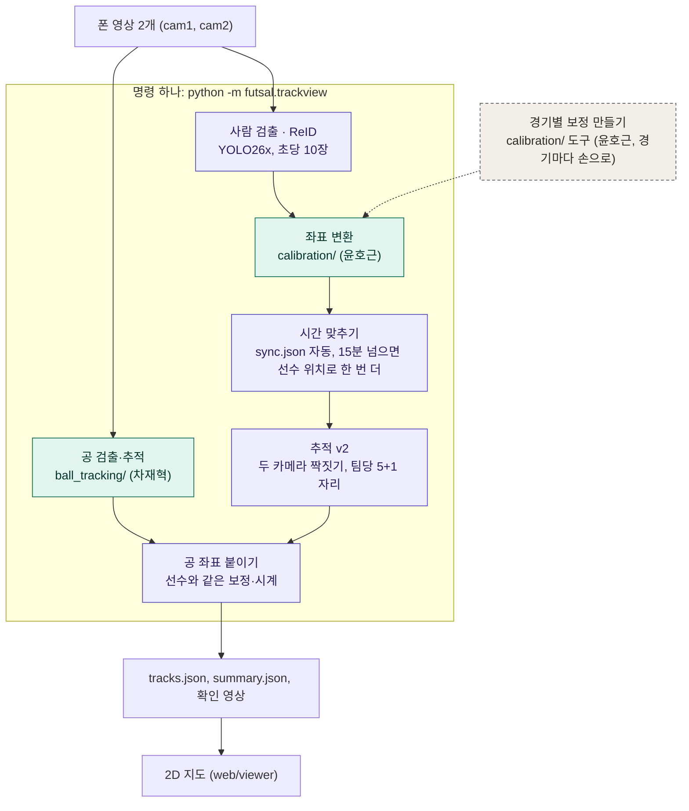

# futsal-analytics

일반 휴대폰 2대로 풋살 경기를 찍어서 **선수와 공의 위치를 2D 지도에 표시하고 이동거리·속도·히트맵을 계산**하는 시스템입니다. (AX 캡스톤 디자인)

지금은 PC에서 팀원 코드와 우리 코드를 한 파이프라인으로 돌려 경기 영상에서 결과를 만듭니다. 최종 목표는 서버 없이 휴대폰 안에서 모두 처리하는 것입니다 → [시스템 구조](docs/architecture.md)


## 파이프라인



| 단계 | 코드 | 맡은 사람 |
|---|---|---|
| 사람 검출 | `src/futsal/pipeline/detect.py` (YOLO26x COCO 사전학습, conf 0.1, 초당 10장) | 우리. `detection/`(차재혁)은 보관, 아래 [검출 비교](#지금까지-확인한-결과) |
| 좌표 변환 | `calibration/`의 `court_map.py`를 그대로 부름 (`src/futsal/nearfar.py`) | 윤호근 (부르는 쪽은 우리) |
| 시간 맞추기, 추적 v2, 팀 나누기, 기록 | `src/futsal/` | 우리 |
| 공 검출·추적 | `ball_tracking/` 스크립트를 그대로 부름 (`src/futsal/pipeline/ball_run.py`) | 차재혁 (부르는 쪽은 우리) |
| 공 좌표 | `src/futsal/pipeline/ball.py` (`ball_tracking/to_court.py`는 안 씀) | 우리 |
| 2D 지도 | `web/viewer/` | 우리 |

`detection/`은 모델 이름 한 줄(`yolo11m.pt` → `yolo26x.pt`) 말고 바꾸지 않았고, `calibration/`과 `ball_tracking/`은 팀원 커밋 그대로입니다. 돌릴 때도 이 폴더들에 아무것도 쓰지 않습니다.

## 한 번에 돌리기

**준비 (한 번):**

```powershell
pip install torch torchvision --index-url https://download.pytorch.org/whl/cu128   # GPU용 torch 먼저 (안 하면 CPU용이 깔림)
pip install -e ".[vision,reid]"        # 저장소 안에서 (calibration/, ball_tracking/ 을 저장소에서 바로 읽음)
pip install --no-deps boxmot           # ReID. GPU용 torch 순서는 src/futsal/pipeline/reid.py 맨 위 설명
```

- 사람 검출 모델 `yolo26x.pt`: 저장소 맨 위 폴더에 둡니다 (없으면 Ultralytics가 내려받음).
- ReID 가중치 `osnet_ain_x1_0_msmt17.pt`: 환경변수 `FUTSAL_REID_WEIGHTS`로 경로를 주거나, 없으면 boxmot이 처음 실행할 때 내려받습니다.
- 공 모델 `best.pt`: 차재혁 님이 팀 구글 드라이브로 공유한 파일입니다 (저장소에는 없음).
- GPU가 있어야 현실적인 시간에 돕니다. 공 검출은 CUDA GPU가 꼭 있어야 합니다 (`ball_tracking/detect_video2.py`가 GPU 0번을 씀).

**실행 (저장소 맨 위 폴더에서):**

```powershell
python -m futsal.trackview --video videos\20261103_165422_sync.mp4 videos\20261103_165851_sync.mp4 `
    --start 600 --duration 180 --out trackview --ball-model best.pt
```

`--start`는 cam1 영상 기준 초입니다. 경기 전체는 `--start 0 --duration <영상 길이>`, 공이 필요 없으면 `--ball-model`을 빼면 됩니다.

**자동으로 되는 것:**

- 영상이 어느 경기의 몇 번 카메라인지: 파일 이름(원본 `20261103_165422.mp4`, 시작을 맞춘 사본 `20261103_165422_sync.mp4`)이나 프레임 수로 `calibration/out/<경기>/sync.json`에서 찾습니다. cam1, cam2 순서가 바뀌면 바로 멈춥니다.
- 좌표 보정: 그 경기의 경기 전체 시간별 보정(`calib_camN.json`)을 영상 시각에 맞춰 씁니다. 카메라가 움직인 구간마다 보정이 따로 있고, HOGEUN이 코트를 못 찾은 구간은 좌표를 비웁니다.
- 두 카메라 시간 차: `--offset`을 안 주면 그 경기의 `sync.json`에서 읽습니다 (사본끼리는 0, 원본끼리는 잘라 낸 시각의 차, 10/8은 124.257초). 15분이 넘는 구간이면 선수 위치로 한 번 더 맞춥니다.
- 공 (`--ball-model`): `ball_tracking/`의 다섯 단계(1280·1920 두 번 검출 → 합치기 → 예비공 지우기(cam2) → 칼만 추적)를 영상마다 한 번 돌리고 결과를 `--out`의 `ball_cam1/` 등에 저장해 다시 씁니다. 공 스크립트는 영상 전체를 돌아서 오래 걸립니다 (차재혁 님 기준 52분 경기에 RTX 5060으로 약 2시간). 공 스크립트는 시각을 프레임 번호로 적는데, 프레임마다 실제 시각으로 고쳐서 씁니다 (11/3 cam1처럼 프레임 간격이 고르지 않은 영상에서 최대 4.6초 어긋나던 것).
- 공 위치: 박스 아래 가운데 점을 선수와 같은 보정·시계·두 카메라 정렬로 옮기고, 프레임마다 공 하나를 고릅니다 (검출이 예측보다 먼저, 그다음 가까운 카메라. 두 카메라 평균은 안 냄. 코트 밖 점도 남김).

**손으로 해야 하는 것:**

- **새 경기 보정:** `calibration/` 도구로 카메라마다 클릭 보정 → 흰 선 맞춤 → 경기 전체 추적을 합니다 ([calibration/README.md](calibration/README.md)).
  - **먼저 경기 이름을 정합니다.** PowerShell이면 `$env:FUTSAL_MATCH = "1120"`. 안 정하면 도구가 `calibration/out/1008`에 써서 10/8 보정을 덮어씁니다.
  - 클릭 화면이 필요해서, `calibration/README.md`대로 따로 만든 가상환경(GUI가 있는 opencv-python)에서 돌립니다. 이 저장소 기본 설치는 화면 없는 opencv입니다.
  - 그다음 trackview에 `--team-calib calibration\out\1120`을 주면, 그 보정을 만든 바로 그 영상 파일일 때 경기 전체 보정을 씁니다. 원본·사본처럼 파일이 다르면 그 경기의 `sync.json`(10/8, 11/3 폴더 참고)이 있어야 합니다.
  - 보정이 없는 경기 영상은 10/8 보정으로 돌면서 알림만 띄우니, 결과를 믿으면 안 됩니다. 코트는 40×20 m만 됩니다.
- **모르는 경기의 원본 영상 시간 차:** `python -m futsal.sync cam1.mp4 cam2.mp4`(ffmpeg 필요) 결과를 `--offset 0 <값>`으로 넣습니다. 일치하는 구간이 적다는 경고가 나오면 `--hint <대략 초>`로 다시 돌립니다 (11/3 원본은 기본값으로 69초 틀렸습니다).
- **공 결과를 따로 만든 경우:** `--ball c1_track.csv c2_track.csv --ball-video <그 CSV를 만든 영상 두 개>`로 넘깁니다. 이렇게 넘긴 CSV는 시각을 고치지 않으니, 프레임 간격이 고르지 않은 영상(11/3 cam1)은 `--ball-model`로 돌리세요.

**결과 (`--out` 폴더):**

| 파일 | 내용 |
|---|---|
| `tracks.json` | 선수별 위치(초당 10장), 공을 넣었으면 `ball` (2D 지도 뷰어 형식) |
| `summary.json` | 선수별 이동거리·속도·보인 비율, 쓴 검출 설정, 보정 파일과 구간, 시간 차, 공 요약 |
| `events.csv` | ID가 경기장 한가운데서 새로 생기거나 끊긴 순간 (ID가 바뀌었을 가능성이 큰 곳) |
| `trackview.mp4` | 확인 영상: 두 카메라 화면 + 2D 지도 (`--no-video`면 안 만듦). 사람이 찍혀 있으니 저장소에 넣지 않습니다 |
| `det_cam1.json`, `ball_cam1/` 등 | 검출 결과 캐시. 같은 설정으로 다시 돌리면 검출을 건너뜁니다 |

**2D 지도로 보기:** 저장소 맨 위에서 `python -m http.server 8080 --bind 127.0.0.1`을 켜고 (이 PC에서만 열림) `http://localhost:8080/web/viewer/?src=/trackview/tracks.json`을 엽니다.

**53분 전체 연구용 (10/8, 저장된 검출로, 추적만 약 9~10분):** `python experiments/full_match.py --out experiments/full_match_team`. 검출은 미리 만든 `experiments/cache_full26`(trackview와 같은 우리 설정)을 쓰는데, 저장소에는 없어서(`.gitignore`) 그 캐시가 있는 PC에서만 돕니다. 새로 만들려면 `experiments/build_cache.py --start 125 --duration 3185 --out experiments/cache_full26`처럼 구간을 적어야 합니다 (기본값은 6분짜리). 공은 `--ball c1_track.csv c2_track.csv --ball-video <공을 돌린 영상>`으로 넣습니다.

옵션 전체와 확인 방법은 [추적 결과 영상 만들기](docs/tracking-check.md)에 있습니다.

## 지금까지 확인한 결과

정답은 10/8 cam1 클립 두 개(9:00, 29:00부터 2분씩)이고, SAM 3 자동 라벨을 AI가 고친 것입니다. 사람은 아직 확인하지 않았습니다.

| | 결과 |
|---|---|
| 정답 클립 IDF1 (9:00 / 29:00) | 0.927 / 0.875 |
| 10/8 53분 | ID 24개, 80% 넘게 같은 ID로 보인 선수 6명, 한가운데서 생기거나 끊긴 ID 17번(분당 0.32), 두 카메라 위치 차 0.83 → 0.184 m |
| 11/3 10:00부터 1분 (실제 영상, 명령 하나) | ID 11개, 사건 1번, 두 카메라 위치 차 0.89 → 0.18 m, PC(RTX 2070 SUPER)에서 173초 |
| 공 스크립트 (11/3 10초 클립) | 우리 환경에서 끝까지 돌고(cam1 네 단계, cam2는 예비공 지우기까지 다섯 단계), cam1 300프레임 중 검출 240, 예측 8 |

**검출 비교** (2026-11-17, 정답 클립 프레임 2400장, IoU 0.5):

| 검출 | 재현율 | 정밀도 | 먼 선수(박스 높이 60 px 미만) 재현율 |
|---|---|---|---|
| 우리 (YOLO26x, conf 0.1, 초당 10장) | 0.987 | 0.822 | 0.919 |
| 우리를 conf 0.3으로 | 0.982 | 0.949 | 0.850 |
| `detection/` (같은 YOLO26x, conf 0.3, 모든 프레임 ByteTrack) | 0.979 | 0.952 | 0.838 |

| 53분 추적, 박스 신뢰도 하한만 바꿈 | ID 수 | 80% 넘게 보인 ID | 한가운데서 생기거나 끊긴 ID | 정답 클립 IDF1 |
|---|---|---|---|---|
| 0.1 (지금) | 24 | 6 | 17번 | 0.927 / 0.875 |
| 0.2 | 28 | 7 | 21번 | 0.927 / 0.884 |
| 0.3 | 26 | 5 | 19번 | 0.932 / 0.882 |

- `detection/`은 같은 모델이라 우리 conf 0.3과 박스가 거의 같고, ByteTrack이 새로 나타난 선수를 확정하기 전 프레임을 빼서 조금 더 놓칩니다. 모든 프레임을 검출해서 60fps 영상은 GPU가 6배 듭니다. 추적 v2는 ByteTrack의 ID를 쓰지 않습니다.
- 53분 전체로는 0.1이 ID와 사건이 가장 적습니다. 정답 클립 IDF1 차이(0.01 이하)는 2분 클립 두 개로는 우열을 말하기 어렵습니다.
- 예전 비교 기록(1분 비교, 11/11 이전 보정 비교)은 [검증 기록](docs/validation-history.md)에 옮겨 두었습니다.

## 아직 안 된 것, 알아 둘 것

- 공 위치는 정답 없이 확인했습니다. 공중에 뜬 공은 바닥으로 투영해서 위치가 틀어지고, 카메라마다 먼 코너 뒤쪽은 사각지대입니다 ([ball_tracking/README.md](ball_tracking/README.md)).
- `summary.json`의 최고 속도는 아직 믿기 어렵습니다. 6분 창이 이어지는 곳이나 추적이 박스 없이 메워 넣은 구간에서 높은 값이 나옵니다.
- `server/`(개발용 PC 도구)는 아직 예전 경로(우리 yolo26s 검출, 앱에서 찍은 탭 보정, appearance 추적)를 써서 이 파이프라인과 결과가 다릅니다.
- 폰 앱(`app/`)과 백엔드는 다음 단계입니다.

**다른 방식으로 되돌리기:** 차재혁 님 `detection/` 검출과 우리 탭 보정(`calib/<cam>/calib.json`)을 부르던 줄은 `src/futsal/trackview.py`, `experiments/full_match.py`에 주석으로 남겨 두었습니다. 주석대로 풀면 됩니다. `calib/`는 저장소에 없어서(`.gitignore`), 탭 보정으로 되돌리려면 [tracking-check.md](docs/tracking-check.md) 1번으로 먼저 만들어야 합니다.

## 무엇이 들어 있나

| 경로 | 내용 | 상태 |
|---|---|---|
| `src/futsal/trackview.py` | 한 번에 돌리기 (위) | ✅ 10/8, 11/3 실제 영상으로 확인 |
| `src/futsal/pipeline/` | 검출, ReID, 추적 v2, 팀 나누기, 공 연결 | ✅ |
| `src/futsal/nearfar.py` | HOGEUN 보정 연결 (경기·카메라·시각 찾기, 시간별 보정) | ✅ |
| `src/futsal/` 나머지 | 코트 규격, 카메라 모델, 기준점 보정, 지표, 시간 맞추기(`sync`), 결과 형식. 앱(Dart)으로 옮길 원본 | ✅ 테스트 있음 |
| `src/futsal/check.py`, `syncview.py` | 촬영 영상 점검, 시간 맞추기 눈으로 확인 | ✅ |
| `src/futsal/camshift.py` | 카메라가 움직인 순간 자동 감지 (보정이 없는 영상용 `--auto-moves`) | ✅ |
| `src/futsal/sim/` | 배치·화각 시뮬레이터, 합성 경기·합성 영상 | ✅ |
| `src/futsal/ball/` | 예전 공 검출 도구. 파이프라인에서는 안 씀 (공은 `ball_tracking/`) | 테스트만 있음 |
| `detection/` | **탐지 (차재혁)**: YOLO 사람 검출 + ByteTrack 스크립트 | 보관 (부르는 줄은 주석) |
| `calibration/` | **좌표 변환 (HOGEUN)**: 카메라마다 두 호모그래피, 흰 선 보정, 경기 전체 시간별 보정 | ✅ 파이프라인에 연결 |
| `ball_tracking/` | **공 검출·추적 (차재혁)**: 공 전용 YOLO26s, 두 해상도 검출, 칼만 추적 | ✅ 파이프라인에 연결 |
| `experiments/` | 연구용 스크립트 (53분 전체, 정답 클립 채점 등) | |
| `server/` | 개발용 PC 도구 (운영 서버 아님) | ✅ 테스트 있음, 예전 경로 |
| `web/viewer/` | 2D 지도 뷰어 (재생, 꼬리, 선수 기록, 히트맵, 공) | ✅ |
| `app/` | Flutter 앱 (폴더는 아직 없음) | ⏳ 다음 단계 |
| `docs/` | 구조, 촬영 가이드, 시뮬레이션, 로드맵, 검증 기록 | |

## 빠른 시작 (PC, 테스트와 도구)

```bash
pip install -e ".[server,sim,dev]"        # 실제 영상까지 돌리려면 위 "준비"도
pytest                                     # 전체 테스트 (fastapi가 없으면 server 테스트는 건너뜀)

uvicorn server.app.main:app --reload       # 개발용 도구: http://localhost:8000 → "데모 경기 만들기"
```

서버 없이 뷰어만 보려면: `python -m http.server -d web/viewer 8080` 후 `http://localhost:8080/?src=sample_tracks.json`

시뮬레이터:
```bash
python -m futsal.sim figures --court 40x20 --twist 5 --out docs/img   # 규격 도면, 커버리지, 데모
python -m futsal.sim fov --out docs/img                                # 화각 그림
python -m futsal.sim twist --court 42x25                               # 그 구장에서 안전한 회전각
python -m futsal.sim accuracy --hfov 67.3                              # 합성 경기 위치 오차
```

## 문서
- [시스템 구조 (폰에서 모두 처리)](docs/architecture.md)
- [촬영 가이드 (설치 위치·각도·설정)](docs/capture-guide.md)
- [추적 결과 영상 만들기 (한 번에 돌리기 옵션과 확인 방법)](docs/tracking-check.md)
- [추적 v2: 방법, 결과, 알게 된 것 (10/8 실제 영상)](docs/tracking-v2.md)
- [선수 ID 추적: 기존 방법 조사와 우리 선택](docs/tracking-survey.md)
- [검증 기록 (예전 비교)](docs/validation-history.md)
- [공 검출·추적 (차재혁)](ball_tracking/README.md), [예전 공 도구 기록](docs/ball-detection.md)
- [시뮬레이션 방법과 결과](docs/simulation.md)
- [로드맵과 다음 단계](docs/roadmap.md)
- [팀원 폰 YOLO 검출 속도 측정 방법](docs/phone-benchmark.md)
- [2026-10-08 테스트 촬영 기록 (영상 점검·시간 맞추기 결과)](docs/capture-2026-10-08.md)
